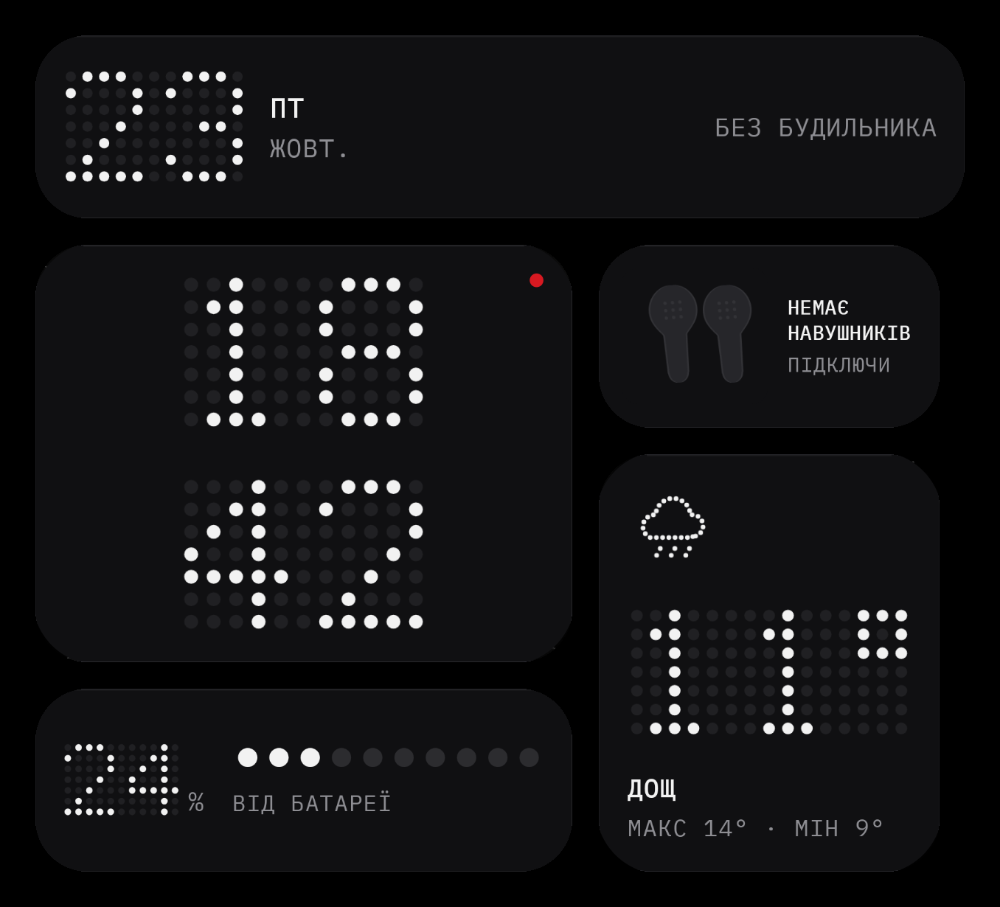
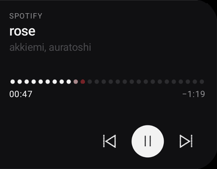

# Dotline Widgets

**Спокійні крапкові віджети для головного екрана Android. Шість нативних віджетів, без акаунта, реклами та аналітики.**

[English](README.md)

> Inspired by Nothing OS design; not affiliated with Nothing Technology Limited.

## Скриншоти

  
  

Справжні скриншоти з Galaxy S25 Ultra (One UI). GIF плеєра обрізано без обкладинки альбому.

## Віджети

| Віджет | Розмір | Що робить |
|---|---|---|
| **Head** | 5x1 | Дата і найближчий будильник в один рядок. |
| **Time** | 3x2 | Великий крапковий годинник з однією червоною крапкою. |
| **Weather** | 2x2 | Температура, стан, максимум / мінімум; червона крапка, якщо скоро дощ. |
| **Player** | 5x2 | Обкладинка, назва, виконавець, кнопки і **покрапковий прогрес з кроком в секунду**. |
| **Power** | 3x1 | Заряд батареї, 10 крапок, статус зарядки. |
| **Buds** | 2x1 | Заряд лівого, правого навушника і кейсу. |

Потрібен Android 12 (API 31) або новіший.

## Встановлення

1. Завантажити `dotline-widgets.apk` з [останнього релізу](../../releases/latest).
2. Дозволити встановлення з невідомих джерел для браузера чи файлового менеджера.
3. Відкрити **Dotline Widgets** і пройти картки налаштування. Для плеєра потрібен **доступ до сповіщень**; якщо перемикач сірий (Samsung): Налаштування > Застосунки > Dotline Widgets > ⋮ > **Allow restricted settings**.
4. Додати віджети кнопкою **ADD TO HOME** або через довге натискання на головному екрані.

Оновлення: застосунок перевіряє GitHub Releases; кожне встановлення підтверджується системним діалогом.
Obtainium: додати `https://github.com/oceansde012/dotline-widgets`.

## Приватність

Без аналітики, реклами і акаунта. Місто зберігається лише на пристрої. Єдині запити: Open-Meteo (погода, пошук міста) і GitHub Releases (перевірка оновлень). Доступ до сповіщень потрібен лише щоб бачити медіасесії; вміст сповіщень не читається. Докладно про дозволи: [README.md](README.md).

## Ліцензії

Код: MIT. Шрифт IBM Plex Mono: SIL OFL 1.1 (точкові цифри малює сам застосунок). Погода: Open-Meteo.com.
