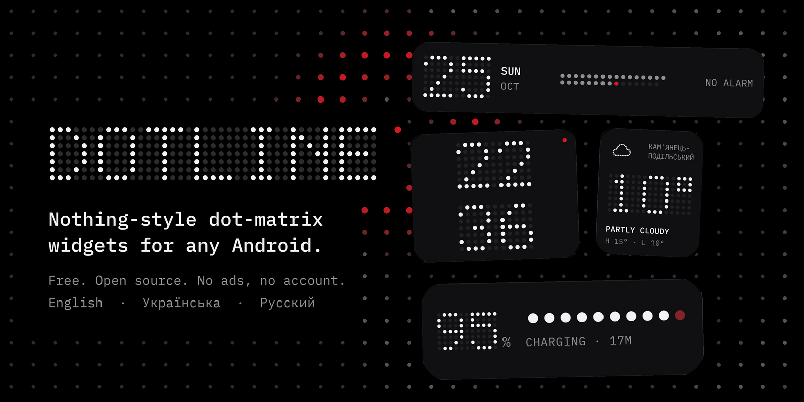
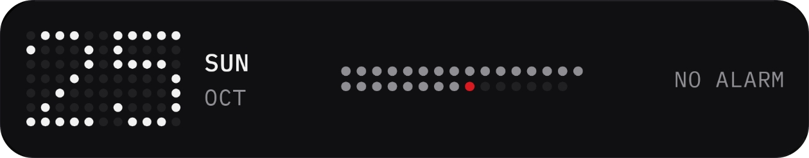
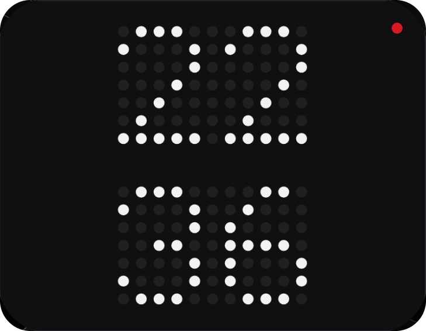
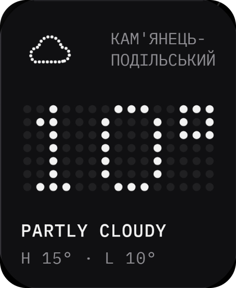
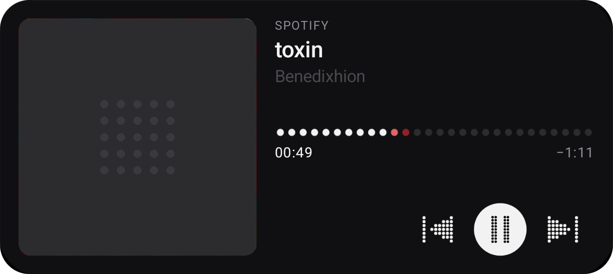
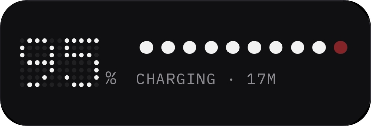

# Dotline Widgets

**Крапкові віджети в стилі Nothing для будь-якого Android-телефона. Шість нативних віджетів, без акаунта, реклами та аналітики. Українська, англійська й російська.**

[English](README.md) · [Завантажити останній APK](../../releases/latest)

> Набір віджетів у стилі Nothing: крапковий вигляд узято як натхнення, але це незалежний проєкт, **не створений Nothing Technology Limited і не повʼязаний з нею**. «Nothing» і «Nothing OS» належать їхнім власникам. Жодного коду, шрифтів, логотипів чи графіки Nothing у додатку немає: крапкові символи й малюнки віджетів малює сам додаток, шрифт підписів відкритий, IBM Plex Mono. (Віджет Buds може показати зображення навушників із застосунку Nothing X, якщо він стоїть на телефоні; нічого з нього не вбудовано.)

## У русі

## Віджети

Справжні скриншоти з Galaxy S25 Ultra (One UI). Обкладинку альбому в плеєрі замінено нейтральним квадратом; місто належить автору.

| Віджет | Розмір | Що робить |
|---|---|---|
| **Head**  | 5x1 | Дата і найближчий будильник в один рядок, місяць крапками (сьогодні червоним). |
| **Time**  | 3x2 | Великий крапковий годинник з однією червоною крапкою. |
| **Weather**  | 2x2 | Температура, стан, максимум / мінімум; червона крапка, якщо скоро дощ. |
| **Player**  | 5x2 | Обкладинка, назва, виконавець, кнопки і **покрапковий прогрес з кроком в секунду**. |
| **Power**  | 3x1 | Заряд батареї, 10 крапок, статус зарядки; під час зарядки остання крапка дихає червоним. |
| **Buds** | 2x1 | Заряд лівого, правого навушника і кейсу, з їхнім зображенням (із застосунку виробника, якщо він є, інакше намальована пара) або «немає навушників». |

Потрібен Android 12 (API 31) або новіший.

## Встановлення

1. Завантажити `dotline-widgets.apk` з [останнього релізу](../../releases/latest).
2. Дозволити встановлення з невідомих джерел для браузера чи файлового менеджера.
3. Відкрити **Dotline Widgets** і пройти картки налаштування. Для плеєра потрібен **доступ до сповіщень**; якщо перемикач сірий (Samsung): Налаштування > Застосунки > Dotline Widgets > ⋮ > **Allow restricted settings**.
4. Додати віджети кнопкою **ADD TO HOME** або через довге натискання на головному екрані.

Оновлення: застосунок перевіряє GitHub Releases; кожне встановлення підтверджується системним діалогом.
Obtainium: додати `https://github.com/oceansde012/dotline-widgets`.

## Приватність

Без аналітики, реклами і акаунта. Місто зберігається лише на пристрої. Єдині запити: Open-Meteo (погода, пошук міста) і GitHub Releases (перевірка оновлень). Доступ до сповіщень потрібен лише щоб бачити медіасесії; вміст сповіщень не читається. Докладно про дозволи: [README.md](README.md).

## Ліцензії

Код: MIT. Шрифт IBM Plex Mono: SIL OFL 1.1 (точкові цифри малює сам застосунок). Погода: Open-Meteo.com.
